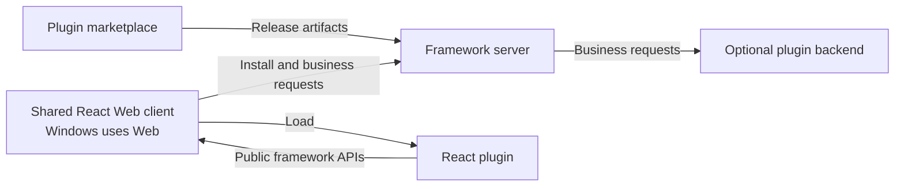

<div align="center">

<h1>Isola</h1>

<p><strong>One plugin. A shared Web client.</strong></p>
<p>A shared home for independent tools.</p>

<p>
  
  <a href="LICENSE"></a>
</p>

<p><strong>English</strong> · <a href="README.zh-CN.md">简体中文</a></p>

<p>
  <a href="docs/superpowers/specs/2026-10-10-react-plugin-framework-design.md">Architecture</a> ·
  <a href="docs/plugin-development.md">Plugin integration</a> ·
  <a href="https://github.com/shenmuegit/Isola/issues">Discuss</a>
</p>

</div>

---

Isola is an open-source framework for community-built React plugins. It includes a public SDK, Web client, server, marketplace and official notes template. **Windows uses the same Web client.**

Plugin authors define their tools and business layouts. Isola provides the common client environment, server integration, installation flow, and adaptation across its supported clients.

> [!NOTE]
> **Web development preview.** A minimal Tauri 2 shell configuration is included; native targets require platform-specific builds and device validation. The SDK is not published to npm. See the [acceptance guide](docs/acceptance.md) for test commands and expected behavior.

Requires Node.js 24, pnpm 10, Docker Engine and Compose. Copy `.env.example` to `.env`, set private random values for `PGPASSWORD` and `BETTER_AUTH_SECRET`, then run:

```sh
pnpm install --frozen-lockfile
pnpm dev
```

Open `http://localhost:5173`, create an account, publish `examples/notes/isola-example-notes-0.1.0.tgz`, then install and open it. `Ctrl+C` stops this run's Vite and containers while preserving existing running containers and data. If this Compose project's core is already running, `pnpm dev` exits before building; use that service or explicitly run `docker compose stop server` before starting development. Existing databases need a native role-password change when adopting the new secret; see the [plugin development guide](docs/plugin-development.md) for that procedure, the package contract and publishing steps.

## 🧭 Design commitments

| Plugin authors decide | Isola takes responsibility for |
| --- | --- |
| Business features and React content | The shared Web client environment and layout adaptation |
| Regions, composition, and layout constraints | Reflow, scrolling, focus, and input behavior within the public component contract |
| Optional server-side business logic | Installation and connection between plugin frontends and backends |

Plugins target Isola's public SDK and use one frontend artifact. The framework maintains layout adaptation; browser and native device validation use separate test environments.

## 🏗️ How the pieces fit

The architecture connects a shared React client, a framework server, community plugins, and a plugin marketplace.



The stack uses React, TypeScript, and Vite for the common interface, and Node.js, Fastify, PostgreSQL, and Docker for server-side integration. The Tauri 2 shell uses native URL configuration to load that same host. Details and platform requirements are in the [architecture document](docs/superpowers/specs/2026-10-10-react-plugin-framework-design.md).

## 🧩 Your plugin, your layout

Authors compose business regions using a small public React API:

- `Stack` arranges content vertically.
- `Columns` places regions in a wrapping horizontal flow.
- `Pane` supplies a named region with CSS sizing constraints.
- `ListDetail` is an optional component for list-and-detail navigation.

The following illustrates the **local SDK API**:

```tsx
import type { ReactNode } from 'react';
import { Columns, Pane, Stack } from '@isola/plugin/ui';

export function NotesLayout({ list, editor, actions }: {
  list: ReactNode;
  editor: ReactNode;
  actions: ReactNode;
}) {
  return (
    <Columns gap="1rem">
      <Pane label="Notes" flexBasis="18rem" flexGrow={1}>
        {list}
      </Pane>
      <Pane label="Editor" flexBasis="30rem" flexGrow={2}>
        <Stack gap="1rem">
          {editor}
          {actions}
        </Stack>
      </Pane>
    </Columns>
  );
}
```

The author defines the structure once. Framework components adapt to the space their container provides, with stable React nodes during size changes.

See the [layout interface and adaptation rules](docs/superpowers/specs/2026-10-10-react-plugin-framework-design.md#插件自定义布局接口) for types, defaults, examples, and acceptance criteria.

## 📚 Explore the project

```sh
git clone https://github.com/shenmuegit/Isola.git
cd Isola
```

| Document | What it covers |
| --- | --- |
| [Architecture](docs/superpowers/specs/2026-10-10-react-plugin-framework-design.md) | Clients, server, plugin delivery, marketplace, and adaptation responsibilities |
| [Layout contract](docs/superpowers/specs/2026-10-10-react-plugin-framework-design.md#插件自定义布局接口) | Composable React layouts and framework-owned responsive behavior |
| [Plugin integration](docs/plugin-development.md) | React layouts, SDK, backend images, databases, local development and publishing |
| [Acceptance](docs/acceptance.md) | Reproducible test commands and expected results |

The detailed design documents are currently written in Simplified Chinese.

## 🤝 Contributing

Contributions are welcome. Useful work includes building plugins against the public SDK and reporting reproducible issues with validation results.

Start with the [architecture](docs/superpowers/specs/2026-10-10-react-plugin-framework-design.md) and [plugin development guide](docs/plugin-development.md). Use [issues](https://github.com/shenmuegit/Isola/issues) to discuss a focused proposal, or submit a [pull request](https://github.com/shenmuegit/Isola/pulls) with its purpose and validation results.

## 📄 License

[MIT](LICENSE) © 2026 Isola contributors.
