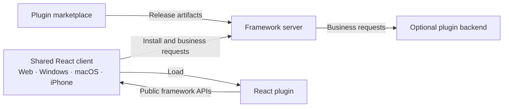

<div align="center">

<h1>Isola <sub>栖屿</sub></h1>

<p><strong>One plugin. Four clients.</strong></p>
<p>A shared home for independent tools.</p>

<p>
  
  <a href="LICENSE"></a>
</p>

<p><strong>English</strong> · <a href="README.zh-CN.md">简体中文</a></p>

<p>
  <a href="docs/superpowers/specs/2026-10-10-react-plugin-framework-design.md">Architecture</a> ·
  <a href="docs/superpowers/plans/2026-10-10-react-plugin-framework-first-version.md">Implementation plan</a> ·
  <a href="https://github.com/shenmuegit/Isola/issues">Discuss</a>
</p>

</div>

---

Isola is an open-source framework being designed for community-built React plugins across **Web, Windows, macOS, and iPhone**.

Plugin authors define their tools and business layouts. Isola provides the common client environment, server integration, installation flow, and adaptation across its supported clients.

> [!NOTE]
> **Design and planning phase.** This repository currently contains the architecture, proposed plugin interfaces, and an implementation plan. A runnable framework and released SDK are not available yet.

## 🧭 Design commitments

| Plugin authors decide | Isola takes responsibility for |
| --- | --- |
| Business features and React content | The shared client environment and four-client adaptation |
| Regions, composition, and layout constraints | Reflow, scrolling, focus, and input behavior within the public component contract |
| Optional server-side business logic | Installation and connection between plugin frontends and backends |

Plugins target Isola's documented contracts. The framework maintains client-specific behavior and verifies the same plugin artifact on each supported client.

## 🏗️ How the pieces fit

The proposed architecture connects a shared React client, a framework server, community plugins, and a plugin marketplace.



The proposed stack uses React, TypeScript, and Vite for the common interface; Tauri 2 for native client shells; and Node.js, Fastify, PostgreSQL, and Docker for server-side integration. Details and platform requirements are in the [architecture document](docs/superpowers/specs/2026-10-10-react-plugin-framework-design.md).

## 🧩 Your plugin, your layout

Authors compose business regions using a small public React API:

- `Stack` arranges content vertically.
- `Columns` places regions in a wrapping horizontal flow.
- `Pane` supplies a named region with CSS sizing constraints.
- `ListDetail` is an optional component for list-and-detail navigation.

The following illustrates the **proposed SDK API**:

```tsx
import type { ReactNode } from 'react';
import { Columns, Pane, Stack } from '@isola/plugin/ui';

export function NotesLayout({ list, editor, actions }: {
  list: ReactNode;
  editor: ReactNode;
  actions: ReactNode;
}) {
  return (
    <Columns gap="1rem">
      <Pane label="Notes" flexBasis="18rem" flexGrow={1}>
        {list}
      </Pane>
      <Pane label="Editor" flexBasis="30rem" flexGrow={2}>
        <Stack gap="1rem">
          {editor}
          {actions}
        </Stack>
      </Pane>
    </Columns>
  );
}
```

The author defines the structure once. Framework components adapt to the space their container provides, with stable React nodes during size changes. Four-client support applies to layouts and interactions that follow the public component contract.

See the [layout interface and adaptation rules](docs/superpowers/specs/2026-10-10-react-plugin-framework-design.md#插件自定义布局接口) for types, defaults, examples, and acceptance criteria.

## 📚 Explore the project

```sh
git clone https://github.com/shenmuegit/Isola.git
cd Isola
```

| Document | What it covers |
| --- | --- |
| [Architecture](docs/superpowers/specs/2026-10-10-react-plugin-framework-design.md) | Clients, server, plugin delivery, marketplace, and adaptation responsibilities |
| [Layout contract](docs/superpowers/specs/2026-10-10-react-plugin-framework-design.md#插件自定义布局接口) | Composable React layouts and framework-owned responsive behavior |
| [Implementation plan](docs/superpowers/plans/2026-10-10-react-plugin-framework-first-version.md) | Seven implementation tasks, interfaces, and verification requirements |

The detailed design documents are currently written in Simplified Chinese.

## 🤝 Contributing

Contributions are welcome. At this stage, useful work includes reviewing the plugin contract, testing the layout assumptions, and implementing tasks from the plan.

Start with the [architecture](docs/superpowers/specs/2026-10-10-react-plugin-framework-design.md) and [implementation plan](docs/superpowers/plans/2026-10-10-react-plugin-framework-first-version.md). Use [issues](https://github.com/shenmuegit/Isola/issues) to discuss a focused proposal, or submit a [pull request](https://github.com/shenmuegit/Isola/pulls) with its purpose and validation results.

## 📄 License

[MIT](LICENSE) © 2026 Isola contributors.
