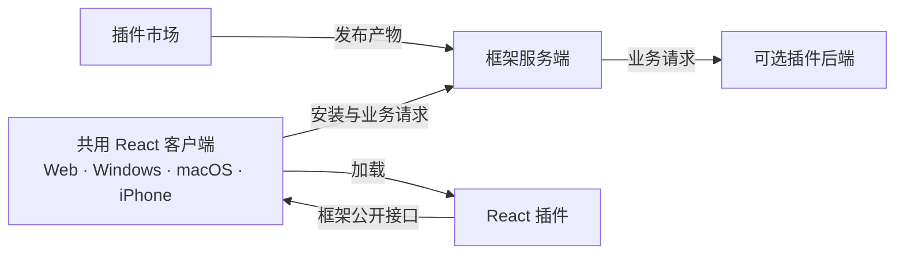

<div align="center">

<h1>Isola</h1>

<p><strong>一次开发，四端使用。</strong></p>
<p>让不同的工具各有空间，又归于一处。</p>

<p>
  
  <a href="LICENSE"></a>
</p>

<p><a href="README.md">English</a> · <strong>简体中文</strong></p>

<p>
  <a href="docs/superpowers/specs/2026-10-10-react-plugin-framework-design.md">技术方案</a> ·
  <a href="docs/superpowers/plans/2026-10-10-react-plugin-framework-first-version.md">实施计划</a> ·
  <a href="https://github.com/shenmuegit/Isola/issues">参与讨论</a>
</p>

</div>

---

Isola 是一个正在设计中的开源 React 插件框架，面向 **Web、Windows、macOS 和 iPhone**。

插件开发者决定业务功能和布局，框架负责共同运行环境、服务端接入、安装流程，以及支持客户端之间的适配。

> [!NOTE]
> **当前处于设计与规划阶段。** 仓库已包含技术方案、拟议插件接口和实施计划；可运行框架与正式 SDK 尚未交付。

## 🧭 设计约定

| 插件开发者决定 | Isola 框架负责 |
| --- | --- |
| 业务功能与 React 内容 | 共同客户端环境和四端适配 |
| 业务区域、组合方式与布局约束 | 公开组件约定内的排版、滚动、焦点和输入行为 |
| 按需编写服务端业务逻辑 | 安装和插件前后端之间的接入 |

插件按 Isola 公开规范开发。客户端差异由框架维护，并使用同一份插件产物在各端验证。

## 🏗️ 四部分如何配合

拟议架构由共用 React 客户端、框架服务端、社区插件和插件市场组成。



建议技术栈使用 React、TypeScript、Vite 实现共用界面，Tauri 2 承载原生客户端，Node.js、Fastify、PostgreSQL 和 Docker 提供服务端接入。具体机制和平台要求见[技术方案](docs/superpowers/specs/2026-10-10-react-plugin-framework-design.md)。

## 🧩 插件决定自己的业务布局

开发者通过少量公开 React 组件组合界面：

- `Stack`：纵向排列内容。
- `Columns`：横向排列业务区域，空间不足时换行。
- `Pane`：提供带名称及 CSS 尺寸约束的业务区域。
- `ListDetail`：可选的列表详情导航组件。

下面展示的是**拟议 SDK 接口**：

```tsx
import type { ReactNode } from 'react';
import { Columns, Pane, Stack } from '@isola/plugin/ui';

export function NotesLayout({ list, editor, actions }: {
  list: ReactNode;
  editor: ReactNode;
  actions: ReactNode;
}) {
  return (
    <Columns gap="1rem">
      <Pane label="记录列表" flexBasis="18rem" flexGrow={1}>
        {list}
      </Pane>
      <Pane label="编辑区域" flexBasis="30rem" flexGrow={2}>
        <Stack gap="1rem">
          {editor}
          {actions}
        </Stack>
      </Pane>
    </Columns>
  );
}
```

插件声明一次业务结构，框架组件根据所在容器的实际空间适配，并在尺寸变化时保留稳定的 React 节点。四端支持承诺覆盖遵守公开组件与交互约定的布局。

完整类型、默认值、示例和验收要求见[布局接口与适配规则](docs/superpowers/specs/2026-10-10-react-plugin-framework-design.md#插件自定义布局接口)。

## 📚 阅读项目

```sh
git clone https://github.com/shenmuegit/Isola.git
cd Isola
```

| 文档 | 内容 |
| --- | --- |
| [技术方案](docs/superpowers/specs/2026-10-10-react-plugin-framework-design.md) | 客户端、服务端、插件交付、市场和适配责任 |
| [布局接口](docs/superpowers/specs/2026-10-10-react-plugin-framework-design.md#插件自定义布局接口) | 可组合 React 布局及框架负责的自适应行为 |
| [实施计划](docs/superpowers/plans/2026-10-10-react-plugin-framework-first-version.md) | 七项实施任务、接口约定及验证要求 |

## 🤝 参与贡献

欢迎社区参与。目前适合贡献的内容包括插件契约评审、布局规则验证，以及实施计划中的具体任务。

先阅读[技术方案](docs/superpowers/specs/2026-10-10-react-plugin-framework-design.md)和[实施计划](docs/superpowers/plans/2026-10-10-react-plugin-framework-first-version.md)，通过 [Issues](https://github.com/shenmuegit/Isola/issues) 讨论具体建议，或提交说明用途与验证结果的 [Pull Request](https://github.com/shenmuegit/Isola/pulls)。

## 📄 许可证

[MIT](LICENSE) © 2026 Isola contributors.
