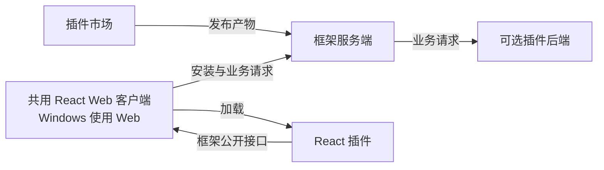

<div align="center">

<h1>Isola</h1>

<p><strong>一次开发，共用 Web 客户端。</strong></p>
<p>让不同的工具各有空间，又归于一处。</p>

<p>
  
  <a href="LICENSE"></a>
</p>

<p><a href="README.md">English</a> · <strong>简体中文</strong></p>

<p>
  <a href="docs/superpowers/specs/2026-10-10-react-plugin-framework-design.md">技术方案</a> ·
  <a href="docs/plugin-development.md">插件接入规范</a> ·
  <a href="https://github.com/shenmuegit/Isola/issues">参与讨论</a>
</p>

</div>

---

Isola 是一个开源 React 插件框架，提供 SDK、Web 客户端、服务端、插件市场和官方笔记模板。**Windows 使用同一 Web 客户端。**

插件开发者决定业务功能和布局，框架负责共同运行环境、服务端接入、安装流程，以及支持客户端之间的适配。

> [!NOTE]
> **Web 开发预览。** 仓库包含最小 Tauri 2 外壳配置；原生目标需要对应平台的构建和设备验证。SDK 尚未发布到 npm。测试命令与预期行为见[验收指南](docs/acceptance.md)。

需要 Node.js 24、pnpm 10、Docker Engine 和 Compose。复制 `.env.example` 为 `.env`，为 `PGPASSWORD` 和 `BETTER_AUTH_SECRET` 设置各自私有的随机值后运行：

```sh
pnpm install --frozen-lockfile
pnpm dev
```

打开 `http://localhost:5173`，创建账号，发布 `examples/notes/isola-example-notes-0.1.0.tgz`，再安装并打开。`Ctrl+C` 关闭本次启动的 Vite 和容器，保留已有运行容器和数据。如果本 Compose 项目的核心服务已运行，`pnpm dev` 会在构建前退出；请使用已有服务，或明确执行 `docker compose stop server` 后再启动开发。已有数据库采用新密码时需要原生角色密码变更；操作步骤、插件契约与发布步骤见[开发指南](docs/plugin-development.md)。

## 🧭 设计约定

| 插件开发者决定 | Isola 框架负责 |
| --- | --- |
| 业务功能与 React 内容 | 共用 Web 客户端环境和布局适配 |
| 业务区域、组合方式与布局约束 | 公开组件约定内的排版、滚动、焦点和输入行为 |
| 按需编写服务端业务逻辑 | 安装和插件前后端之间的接入 |

插件按 Isola 公开 SDK 开发并交付同一份前端产物。布局适配由框架维护，浏览器和原生设备使用各自的测试环境验证。

## 🏗️ 四部分如何配合

架构由共用 React 客户端、框架服务端、社区插件和插件市场组成。



技术栈使用 React、TypeScript、Vite 实现共用界面，Node.js、Fastify、PostgreSQL 和 Docker 提供服务端接入。Tauri 2 外壳通过原生 URL 配置加载同一宿主。具体机制和平台要求见[技术方案](docs/superpowers/specs/2026-10-10-react-plugin-framework-design.md)。

## 🧩 插件决定自己的业务布局

开发者通过少量公开 React 组件组合界面：

- `Stack`：纵向排列内容。
- `Columns`：横向排列业务区域，空间不足时换行。
- `Pane`：提供带名称及 CSS 尺寸约束的业务区域。
- `ListDetail`：可选的列表详情导航组件。

下面展示的是**仓库内 SDK 接口**：

```tsx
import type { ReactNode } from 'react';
import { Columns, Pane, Stack } from '@isola/plugin/ui';

export function NotesLayout({ list, editor, actions }: {
  list: ReactNode;
  editor: ReactNode;
  actions: ReactNode;
}) {
  return (
    <Columns gap="1rem">
      <Pane label="记录列表" flexBasis="18rem" flexGrow={1}>
        {list}
      </Pane>
      <Pane label="编辑区域" flexBasis="30rem" flexGrow={2}>
        <Stack gap="1rem">
          {editor}
          {actions}
        </Stack>
      </Pane>
    </Columns>
  );
}
```

插件声明一次业务结构，框架组件根据所在容器的实际空间适配，并在尺寸变化时保留稳定的 React 节点。

完整类型、默认值、示例和验收要求见[布局接口与适配规则](docs/superpowers/specs/2026-10-10-react-plugin-framework-design.md#插件自定义布局接口)。

## 📚 阅读项目

```sh
git clone https://github.com/shenmuegit/Isola.git
cd Isola
```

| 文档 | 内容 |
| --- | --- |
| [技术方案](docs/superpowers/specs/2026-10-10-react-plugin-framework-design.md) | 客户端、服务端、插件交付、市场和适配责任 |
| [布局接口](docs/superpowers/specs/2026-10-10-react-plugin-framework-design.md#插件自定义布局接口) | 可组合 React 布局及框架负责的自适应行为 |
| [插件接入规范](docs/plugin-development.md) | React 布局、SDK、后端镜像、数据库、本地联调与发布 |
| [验收指南](docs/acceptance.md) | 可复现的测试命令与预期结果 |

## 🤝 参与贡献

欢迎社区参与。可以基于公开 SDK 开发插件，或提交带复现步骤和验证结果的问题。

先阅读[技术方案](docs/superpowers/specs/2026-10-10-react-plugin-framework-design.md)和[插件开发指南](docs/plugin-development.md)，通过 [Issues](https://github.com/shenmuegit/Isola/issues) 讨论具体建议，或提交说明用途与验证结果的 [Pull Request](https://github.com/shenmuegit/Isola/pulls)。

## 📄 许可证

[MIT](LICENSE) © 2026 Isola contributors.
