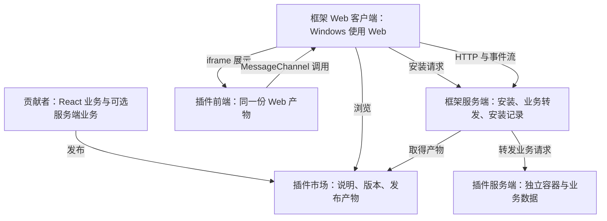

# Isola 技术方案

_2026-10-11 · 当前实现与已确认约定；实际通过项和未完成项见[验收记录](../../acceptance.md)。_

## 📋 当前事实与已确认要求

Isola 已实现公开 SDK、Web 宿主、真实会话、插件市场、Docker 后端安装及官方笔记模板。当前只验收 Web，Windows 使用同一 Web 客户端。Tauri 共用外壳配置已生成；原生 Windows、macOS、iPhone 未构建或运行，SDK 未发布到 npm。Grove 给定网页对应的原型已在独立测试副本中按公开规则安装。

用户已确认：

- 项目开源，社区能够基于框架开发 React 插件。
- 原目标包括 Web、Windows、macOS 和 iPhone，并提供对应服务端；当前验收已确认为 Web，Windows 使用 Web。
- 插件开发者面向框架开发一次，客户端适配由框架维护者负责。
- 插件遵守框架的导入与开发规则，符合规则后才能正确安装。
- 用户从插件市场点击安装，安装完成后直接使用完整业务功能。
- 框架提供统一页面结构、基础组件和公开能力，贡献者主要实现业务。
- 框架定义插件规范，由插件作者适配规范；使用官方示例验证框架本身的能力。
- 开发者决定业务布局，客户端适配由框架负责；当前验证范围为 Web。

共用前端产物和服务端数据用于保持业务操作与结果一致；界面随容器可用空间调整。当前验证范围为验收记录中的浏览器，不代表原生四端已通过。

## 🏗️ 最小技术结构

React Web 是共同前端，Windows 使用 Web。`apps/client/src-tauri` 是官方 Tauri 2 CLI 生成的共用外壳；原生构建和设备兼容性未验证。Tauri 本身提供桌面、移动目标及系统 WebView。[^1][^2]

| 部分 | 使用技术 | 职责 |
| --- | --- | --- |
| 共用客户端界面 | React、TypeScript、Vite | 导航、市场、安装入口、插件展示 |
| 原生客户端外壳 | Tauri 2 | 系统窗口、客户端构建、签名和平台配置 |
| 插件前端 | React、框架组件和调用接口 | 一份业务界面及交互逻辑 |
| 框架服务端 | Node.js、TypeScript、Fastify | 市场发布信息、安装、客户端请求和插件后端接入 |
| 持久数据 | PostgreSQL、服务器文件目录 | 安装记录、发布信息、业务数据与插件静态产物 |
| 可选插件服务端 | 框架提供的 Node.js 模板、Docker | 一份服务端业务实现，按插件独立运行 |

Vite 生成 Web 产物，Fastify 提供市场、安装、业务请求和静态资源。[^3][^4]



市场页面复用客户端 React 工程，市场 HTTP 功能与安装功能放在同一个服务端项目中。图中按职责区分它们，不要求分别部署。

## 📦 插件交付与加载

### 一份前端产物

贡献者从官方模板编写 React 页面。模板负责 React 挂载、框架组件接入及构建配置，输出标准 HTML、JavaScript、CSS 和静态资源。客户端加载同一份产物，当前已验证 Web。

插件前端在原生 `iframe` 中运行，使用 `sandbox="allow-scripts allow-forms"` 保持不透明源并允许标准表单。插件所有静态资源响应使用相同的 CSP sandbox，并允许沙盒跨源加载。[^5][^13]

插件调用接口使用浏览器原生 `MessageChannel` 与宿主通信。宿主将通道绑定到实际加载的插件，承接已公开的操作，再调用服务端；插件自行提交的标识不能决定请求属于哪个插件。社区脚本不直接取得宿主页面的用户凭据。[^6]

这些机制用于明确社区插件与宿主的执行边界。布局和交互适配由下面的框架组件承担。

### 最小交付信息

插件清单沿用 npm `package.json` 和 `.tgz` 格式，框架字段位于 `isola`，包含唯一标识、名称、插件版本、要求的框架接口版本、前端入口，以及存在自定义服务端业务时的服务端镜像：

| 信息 | 用途 |
| --- | --- |
| 插件标识 | 确定安装对象与业务归属 |
| 名称、说明 | 市场展示 |
| 插件版本 | 对应同一次发布的前后端产物 |
| 框架接口版本要求 | 判断当前框架能否运行该插件 |
| 前端入口与静态产物 | 客户端加载同一份界面 |
| 服务端镜像，可选 | 运行插件的服务端业务 |

客户端支持范围由框架维护；贡献者只声明框架接口要求。插件后端是需要时额外交付的一份业务实现，通过共用服务访问。

## 🖥️ 框架如何负责布局适配

### 共用 React DOM

Web（包括 Windows）在浏览器中运行插件。Tauri 外壳通过原生 `build.devUrl` / `build.frontendDist` 加载同一宿主；开发地址为 `http://localhost:5173`，本地构建宿主由核心服务在 `http://localhost:3000` 提供，部署时直接修改为实际服务 URL。原生系统 WebView 行为未验证。插件保持 React Web 的 DOM、CSS 和浏览器事件模型。

贡献者使用同一份 React 代码和同一份发布产物；当前浏览器引擎与通过结果见验收记录，尚未确定原生最低系统版本或验证签名。

### 统一标题栏与业务菜单

宿主使用一个标题栏与原生 Popover，显示市场、当前用户已安装插件、当前插件业务操作和账号退出。安装记录由宿主与市场共用，安装成功按现有 `name` 替换入口；失败保留原入口，用户变化时清空旧状态并取消旧读取。

SDK 0.1.1 在 API 版本 1 的绑定 MessageChannel 上增加 `registerMenu(items: PluginMenuItem[]): () => void`。条目为 `id`、`label`、`disabled?`、`file?: { accept: string; multiple?: boolean }`、`onSelect: (files: File[]) => void | Promise<void>`。宿主接收条目数据，函数留在插件；文件由宿主原生输入选择。注册替换、清理和迟到错误按注册标识处理，断开或重载清空菜单。实际预览升级结果单独记录在验收文档。

### 插件自定义布局接口

插件作者决定业务区域、顺序、嵌套关系、期望宽度和相对占比，区域内部使用普通 React 内容。框架提供可组合的布局组件，并根据当前区域的实际可用空间处理排版和输入适配。

相关实践已核对：Radix 将布局与内容、交互分开，提供接近 CSS 的布局属性；Every Layout 展示了按内容与容器约束组合自适应布局；Radix 的公开讨论也呈现了精简接口与布局自由度之间的权衡。以下接口据此采用组合式 React 组件、原生 CSS 属性名与长度单位；组件已由本项目实现。[^17][^18][^19]

`@isola/plugin/ui` 已导出以下公开 React 接口：

```ts
import type { CSSProperties, ReactElement, ReactNode } from 'react';

export type StackProps = {
  gap?: CSSProperties['gap'];
  children: ReactNode;
};

export type ColumnsProps = {
  gap?: CSSProperties['gap'];
  children: ReactNode;
};

export type PaneProps = {
  label: string;
  flexBasis?: CSSProperties['flexBasis'];
  flexGrow?: number;
  children: ReactNode;
};

export type ListDetailProps = {
  list: ReactNode;
  detail: ReactNode;
  hasSelection: boolean;
  onBack: () => void;
};

export declare function Stack(props: StackProps): ReactElement;
export declare function Columns(props: ColumnsProps): ReactElement;
export declare function Pane(props: PaneProps): ReactElement;
export declare function ListDetail(props: ListDetailProps): ReactElement;
```

| 接口或属性 | 确定行为 |
| --- | --- |
| `Stack` | 子项按 React 声明顺序纵向排列，可包含业务内容及嵌套布局 |
| `Columns` | 直接业务区域使用 `Pane`；支持 React 数组、Fragment 与条件渲染，横向排列并按声明顺序自动换行 |
| `Pane` | 承载业务内容，可包含 `Stack` 或 `Columns`；`label` 为必填的区域可访问名称 |
| `gap` | 接受 React 的原生 CSS gap 类型，默认 `1rem`；控制同组相邻项的间距，取合法非负值 |
| `flexBasis` | 接受 React 的原生 CSS flexBasis 类型，默认 `20rem`；表示区域在横向布局中的期望宽度 |
| `flexGrow` | 有限且非负，默认 `1`；同一行额外宽度按此权重分配，`0` 表示不主动扩展 |
| `ListDetail` | 可选的两区域业务组件；宽屏并排，窄屏按 `hasSelection` 显示列表或详情，返回操作调用 `onBack` |

`flexBasis` 和 `flexGrow` 参与所在 `Columns` 的横向排版；`Pane` 在 `Stack` 中按纵向内容布局。`gap`、`flexBasis` 的数字沿用 React style 的 CSS 像素语义，字符串接受合法的原生 CSS 值，例如 `18rem`、`30ch`；`flexGrow` 是无单位权重。间距和尺寸直接交给浏览器排版。期望宽度用于排版取舍，不是终端尺寸判断。区域遇到更窄的父容器时允许缩小到可用宽度。[^20]

例如，插件可以自行组合记录列表、编辑内容和操作区域：

```tsx
import type { ReactNode } from 'react';
import { Columns, Pane, Stack } from '@isola/plugin/ui';

export function NotesLayout({ list, editor, actions }: {
  list: ReactNode;
  editor: ReactNode;
  actions: ReactNode;
}) {
  return (
    <Columns gap="1rem">
      <Pane label="记录列表" flexBasis="18rem" flexGrow={1}>
        {list}
      </Pane>
      <Pane label="编辑区域" flexBasis="30rem" flexGrow={2}>
        <Stack gap="1rem">
          {editor}
          {actions}
        </Stack>
      </Pane>
    </Columns>
  );
}
```

这段布局声明随插件 React 代码构建和分发。插件决定业务结构；相同代码在不同可用空间中由框架组件排版，沿用现有清单和安装链路。

框架直接使用 CSS Flexbox 的换行及伸缩机制实现 `Stack`、`Columns`、`Pane`。具体规则如下：[^16]

| 场景 | 框架负责的结果 |
| --- | --- |
| 一行能容纳区域期望宽度与间距 | 按业务声明顺序横向排列，每行独立分配剩余宽度 |
| 一行无法容纳全部区域 | 自动换行，所有区域保留，阅读与键盘顺序保持一致 |
| 单一区域的期望宽度超过父容器 | 限定在父容器宽度内，必要的横向查看留在区域内部 |
| 多层布局嵌套 | 每层依据自己的可用宽度排版 |
| 字体放大或页面缩放 | 浏览器按 CSS 单位重新计算空间，框架保持区域与操作可达 |
| 容器尺寸变化或软键盘出现 | 调整可见区域与滚动，维持内容和操作可达 |

`ListDetail` 的窄屏切换由组件内部的容器查询处理，首版分界为 `48rem`；这是该组件的适配规则，通用 `Columns` 依据区域期望宽度换行。容器查询使用浏览器原生能力。[^7]

框架尺寸适配保持同一 React 树、组件位置和 key，区域显隐保持节点挂载，并正确处理可见区域焦点。编辑状态依照 React 原生规则保留。[^15]

布局尺寸和区域组合通过上述公开属性表达；业务样式作用于区域内容，并保留框架布局节点的宽度、换行、滚动与焦点约定。当前通过项仅覆盖验收记录中的普通 React 内容、布局组件与公开调用能力。

### 可见区域和输入

框架客户端负责安全区域和实际可见高度，基础组件负责滚动、焦点、输入框及操作区域。浏览器测试已覆盖可见高度缩小后的输入和操作可达；真实软键盘、安全区域及触摸设备操作未验证。[^8][^9]

文件选择使用标准 HTML 文件输入，插件使用浏览器提供的 `File` / `Blob` 等对象。业务接口直接接收文件内容。[^14]

### 平台能力的共同语义

第一版公开能力采用 Web 标准与服务端 HTTP。`@isola/plugin` 导出 `connect`、`PluginManifest`、`manifestSchema`、`PLUGIN_API_VERSION`，以及 `RequestOptions`、`PluginClient`、`BridgeMessage` 类型。

需要执行命令、调用模型或持续运行任务的业务由插件服务端承担。客户端通过同一份业务接口访问确定的服务端资源，执行位置保持一致。

`connect(): Promise<PluginClient>` 提供 `request<T>(path, options?)` 和 `subscribe(path, listener)`；订阅返回取消函数。普通对象使用 JSON，`File` / `Blob` 保持原生请求体；HTTP 204 返回 `undefined`，其他失败响应拒绝请求。事件使用 SSE；内部 `BridgeMessage` 包含 `disconnect`，插件离开时宿主清理已绑定通道的请求和订阅。

### 数据一致

需要跨设备保留的业务数据持久化在服务端。框架安装记录也保存在服务端，客户端连接后读取；当前已验证同一 Web 客户端保存、刷新并重新打开。

这通过共同的数据来源实现。同一用户通过独立 Firefox 会话读取 Grove 同一安装版本与保存内容已验证。

## 🖥️ 服务端与市场如何配合

### 服务端职责

框架服务端管理插件版本和安装记录，提供前端静态产物，并将插件的业务请求转发给对应服务端。

有自定义后端的插件使用框架提供的 Node.js 服务端模板。模板处理服务启动、框架用户上下文接入和请求入口，贡献者编写业务处理。浏览器请求中的用户信息由框架服务端确认，插件服务端接收可信的请求上下文。

清单、镜像启动、公开 SDK 请求、用户身份、数据库归属及升级验收条件统一见[插件后端接入规范](../../plugin-backend.md)。

Docker 按插件运行独立服务，使用独立 PostgreSQL 业务数据库与角色。容器使用 Docker 原生运行隔离，数据库权限使用 PostgreSQL 原生角色及授权；插件服务端不取得框架管理数据库或其他插件的数据凭据。[^10][^11]

同一插件版本在一套框架部署中提供共享服务，用户安装记录决定该用户是否启用它。服务端依赖和部署参数由框架部署与安装入口处理，终端用户不需要自行启动 Node.js、数据库或容器。

### 市场安装过程

同一插件以 `name` 为唯一标识，市场只显示一个入口。未安装时安装最新发布版本；已安装时显示当前版本并可直接打开，有新版本时在同一入口更新。每个用户、每个插件只有一条安装记录，安装成功后覆盖其版本指向；失败保留原版本和业务数据。

1. 贡献者发布同一版本的插件说明、前端包和可选服务端镜像。
2. 用户在市场点击安装，客户端将安装请求交给框架服务端。
3. 服务端按导入规则确认发布信息、入口、前后端产物和当前框架接口版本是否匹配，并取得产物；客户端加载时同样确认自身接口版本能运行该插件。
4. 有插件后端时，服务端完成运行条件检查、启动和初始化，并确认服务可用。
5. 必需步骤成功后，服务端写入用户安装记录，客户端显示插件入口并加载前端。
6. 插件通过框架调用接口访问对应后端，用户开始使用。

依赖不足、框架接口不兼容或服务端初始化失败时，安装返回具体原因；只有成功完成的安装才写入安装记录。用户已确认由框架在启动前保留业务库副本，启动失败后恢复。新建或已停止的后端启动前，在同插件 PostgreSQL advisory lock 内停止旧后端、禁用数据库连接并终止会话，再创建管理员持有且禁止连接的原生 `TEMPLATE` 副本；已运行且健康的后端直接复用。副本保留至安装记录与 `plugins.backend_backup` 清除在同一事务提交。启动或记录失败时先成功移除候选容器，再恢复业务库、设置、私有权限及原有运行后端。恢复失败保留副本与引用，并拒绝后续自动建库或启动；提交后副本清理失败记录错误，不回滚已提交安装。

导入检查用于确认结构和运行条件。完整业务功能由真实场景验收证明，入口存在和服务启动不能替代业务验收。

## 🔧 贡献者开发方式

`examples/notes` 已作为可复制模板，使用公开 SDK、布局组件和独立 Node.js 后端。

开发过程如下：

1. 使用官方模板创建插件，编写 React 业务界面。
2. 自行组合 `Stack`、`Columns`、`Pane` 表达业务布局，按业务需要使用可选 `ListDetail`；通过框架调用接口接入业务能力。
3. 有自定义后端时，在模板内编写一份 Node.js 服务端业务逻辑。
4. 运行 `pnpm dev` 构建产物并启动 Compose 与 Vite，在 `http://localhost:5173` 实际发布、安装和打开插件。
5. 使用模板构建配置生成发布产物，发布到插件市场。

模板、组件和调用接口随框架接口版本一起维护。插件业务测试由贡献者编写；框架维护者负责框架验收。统一开发命令已在 Linux Node/Docker 环境实际通过启动、市场业务和停止保留数据验证；Windows 原生子进程取消与退出竞态通过 4 项检查，这些不是原生客户端验收。

## ✅ 与目标对应的验收

| 验收对象 | 必须证明的结果 |
| --- | --- |
| 一次开发 | 贡献者交付同一份 React 源码和同一份前端产物；客户端差异处理位于框架 |
| 自定义布局 | 同一插件可声明单列、多列与嵌套布局；区域顺序、期望宽度和占比按公开接口生效 |
| Web 安装使用 | 当前只验收 Web，Windows 使用 Web；原生 macOS、iPhone 未验证 |
| 布局和输入 | 宽窄屏、嵌套、字体放大及缩放下保持区域可达；鼠标、触摸、键盘、软键盘和安全区域下操作可用，尺寸适配不重建编辑节点或丢失草稿 |
| 前后端配合 | 用户安装后能实际完成业务请求，服务端依赖由框架安装与部署入口处理 |
| 数据保留 | 同一 Web 客户端保存后刷新并重新打开，以及独立 Firefox 会话读取 Grove 同一安装版本与保存内容均已验证 |
| 安装失败 | 不兼容或后端失败有具体错误，已有插件和业务数据保留 |
| 社区代码边界 | 插件不能取得宿主用户凭据或其他插件数据库权限；伪造插件标识不能改变请求归属 |
| 市场使用 | 用户能浏览、安装并直接打开插件，安装记录与运行的版本一致 |

官方示例插件自行组合公开布局组件，验证创建、编辑、保存并重新打开记录、接收服务端事件，以及在不同可用宽度下保留编辑状态。布局测试同时覆盖纯组合布局和可选 `ListDetail`。示例按框架公开规范编写，作为贡献者开发模板的实际参照。

浏览器页面缩放、真实软键盘和安全区域，以及原生客户端均未验证。Playwright WebKit 不等同于 Safari 或 iPhone 真机；业务库恢复验证覆盖安装过程中的可捕获故障，未验证进程崩溃或存储故障后的自动恢复。详见[验收记录](../../acceptance.md)。

[^1]: Tauri. [What is Tauri?](https://v2.tauri.app/start/)
[^2]: Tauri. [Webview versions](https://v2.tauri.app/reference/webview-versions/)
[^3]: Vite. [Building for production](https://vite.dev/guide/build.html)
[^4]: Fastify. [Getting started](https://fastify.dev/docs/latest/Guides/Getting-Started/)
[^5]: MDN. [HTML iframe element](https://developer.mozilla.org/en-US/docs/Web/HTML/Reference/Elements/iframe)
[^6]: MDN. [MessageChannel](https://developer.mozilla.org/en-US/docs/Web/API/MessageChannel)
[^7]: MDN. [CSS container queries](https://developer.mozilla.org/en-US/docs/Web/CSS/CSS_containment/Container_queries)
[^8]: MDN. [VisualViewport](https://developer.mozilla.org/en-US/docs/Web/API/VisualViewport)
[^9]: MDN. [Pointer events](https://developer.mozilla.org/en-US/docs/Web/API/Pointer_events)
[^10]: Docker. [Docker Engine security](https://docs.docker.com/engine/security/)
[^11]: PostgreSQL. [Privileges](https://www.postgresql.org/docs/current/ddl-priv.html)
[^13]: MDN. [Content-Security-Policy sandbox directive](https://developer.mozilla.org/en-US/docs/Web/HTTP/Reference/Headers/Content-Security-Policy/sandbox)
[^14]: MDN. [File input](https://developer.mozilla.org/en-US/docs/Web/HTML/Reference/Elements/input/file)
[^15]: React. [Preserving and resetting state](https://react.dev/learn/preserving-and-resetting-state)
[^16]: MDN. [Mastering wrapping of flex items](https://developer.mozilla.org/en-US/docs/Web/CSS/CSS_flexible_box_layout/Mastering_wrapping_of_flex_items)
[^17]: Radix Themes. [Layout](https://www.radix-ui.com/themes/docs/overview/layout)
[^18]: Every Layout. [The Sidebar](https://every-layout.dev/layouts/sidebar/)
[^19]: Radix Themes community. [Layout API ergonomics discussion](https://github.com/radix-ui/themes/discussions/96)
[^20]: React. [Applying CSS styles](https://react.dev/reference/react-dom/components/common#applying-css-styles)
